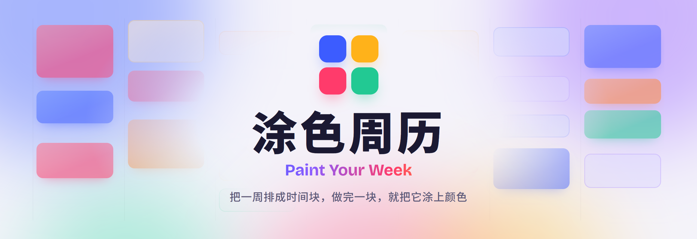
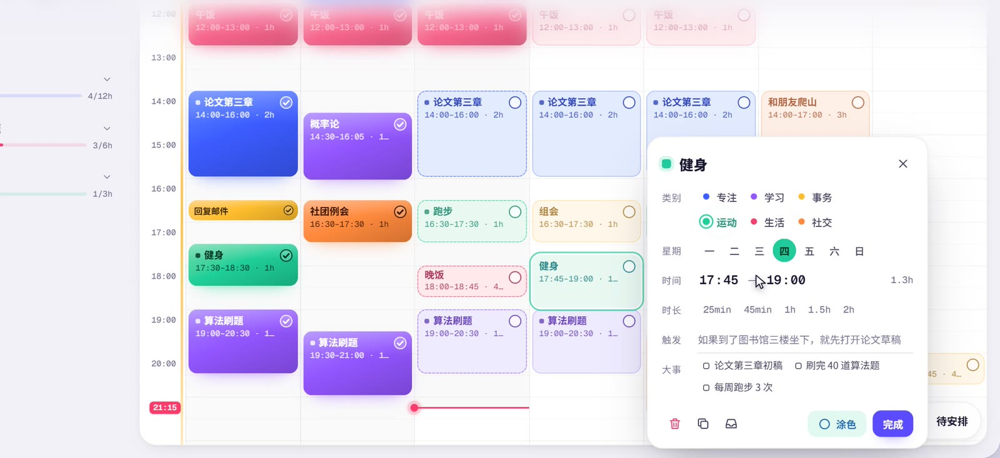
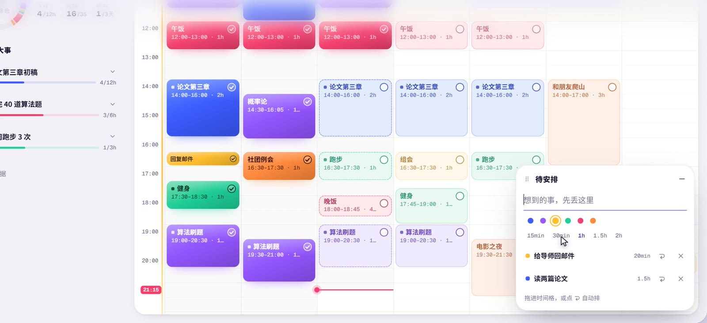
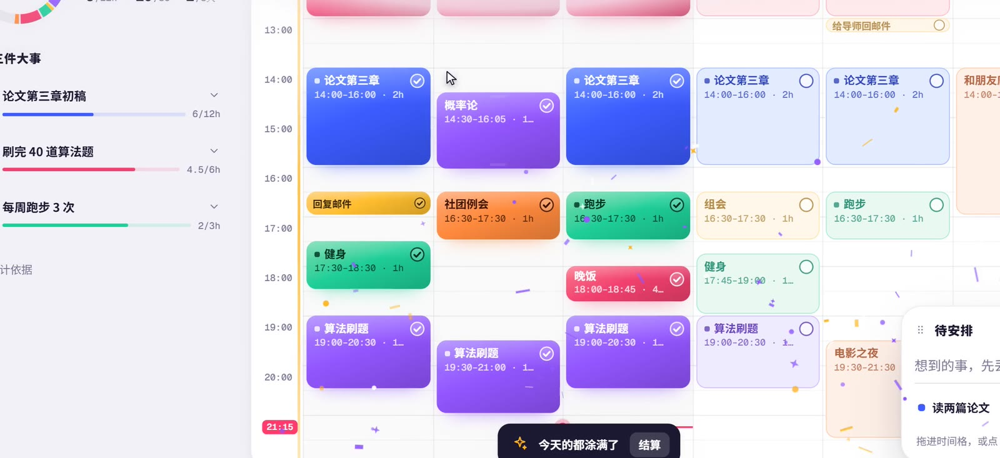
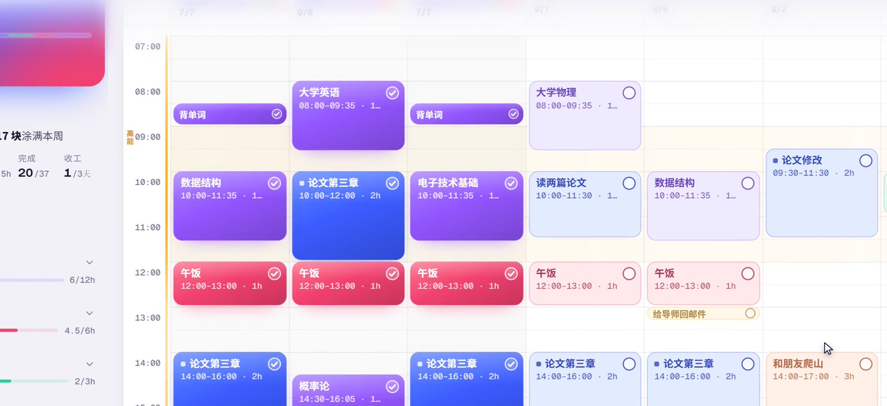
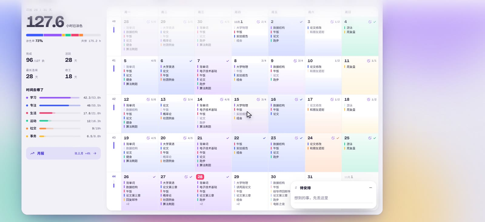
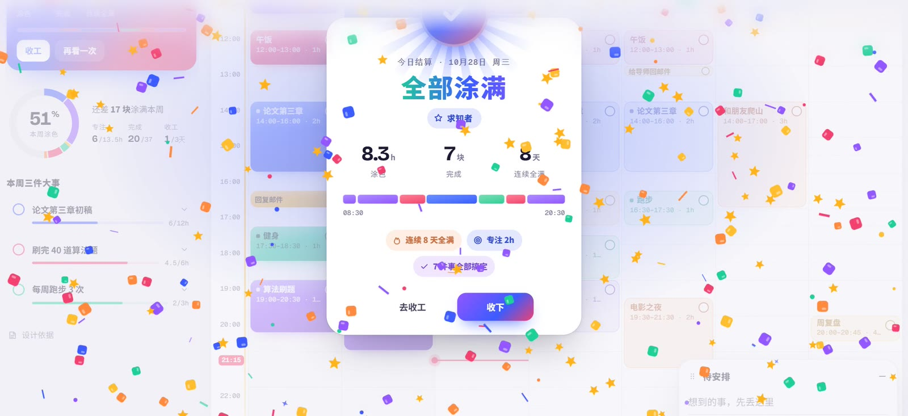
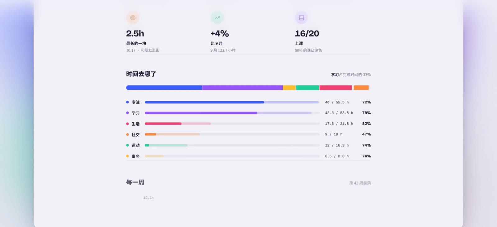
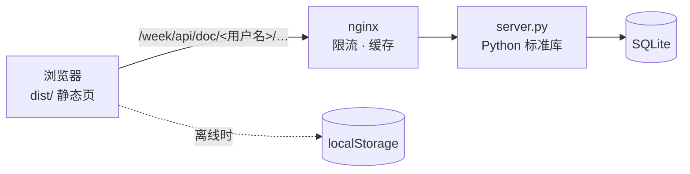

<div align="center">

<picture>
  <source media="(prefers-color-scheme: dark)" srcset="docs/banner-dark.png">
  
</picture>

<h3>把一周排成时间块，做完一块，就把它涂上颜色。</h3>

<p>
  <a href="#-功能一览"><b>功能</b></a>
  &nbsp;·&nbsp;
  <a href="#-为什么这样设计"><b>设计依据</b></a>
  &nbsp;·&nbsp;
  <a href="#-快速开始"><b>快速开始</b></a>
  &nbsp;·&nbsp;
  <a href="#-自己部署"><b>自己部署</b></a>
  &nbsp;·&nbsp;
  <a href="https://github.com/FPSZ/paint-your-week/releases/latest"><b>高清宣传片</b></a>
</p>

<p>
  
  
  
  
  
</p>

https://github.com/user-attachments/assets/4bff725e-642b-467b-8b02-f29dbf27359d

<sub>🔊 建议打开声音。画面由真实操作逐帧渲染，配乐和音效按操作的节拍合成。<a href="https://github.com/FPSZ/paint-your-week/releases/latest">下载高清版</a></sub>

</div>

<br>

## ✨ 功能一览

### 🖌️ 拖一下，就是一段时间

在网格上拖出时间块，拖动或拉伸上下边缘就能改时间。拖动时，方块上实时显示落点时间；靠近旁边的方块会自动贴合，课和课之间严丝合缝。按住 <kbd>Alt</kbd> 拖动可以复制。



### 📥 想到就写，拖进去就排好

右下角的「待安排」随手记，输入 `读两篇论文 90min` 会自动识别时长。可以拖进网格，也可以让它自己找空档。左侧卡片会在空档里提示「先做」哪一件放得下的事。



### 🎨 做完一块，涂一块

按住圆圈蓄力：环一点点填满，圆圈越抖越厉害，蓄力音一路升高；环满的那一刻，整块被涂上饱和色，彩带和音效一起炸开。进度环、每日进度条和周进度一起往前走。



### ⚡ 难的事，放进你的高能时段

按作息类型（早鸟 / 中间 / 夜猫）画出金色高能时段。点 ✨，深度任务会优先排进高能时段里最合适的空档。



### 🗓️ 一个月，一幅画

月视图里，每天按完成度上色；左侧是本月的涂色时长、涂色率、最长连续天数和分类。待办可以直接拖到某一天。



### 🎉 今天，全部涂满

一天的块全部涂完，左侧卡片变成彩色，问你「今天的任务都完成了吗？」。点「结算」，就会放一场全屏结算：彩带炮、色块雨、勋章、称号、今日色卡和成就。



### 📊 每周复盘 · 每月月报

复盘和月报一节一节展开：亮点、时间去哪了、每一周、节奏、做得最多的事、大事完成情况，最后写给下周 / 下个月。



<details>
<summary><b>还有这些</b></summary>

<br>

- **周计划仪式**：回顾上周 → 写三件大事（带 WOOP）→ 铺底 → 给大事排深度块 → 检查每天负荷。
- **收工仪式**：处理今天剩下的块、清空大脑、看一眼明天。
- **专注模式**：一次只看一件事，带倒计时环和下一项预告。
- **课表导入**：五邑大学教务系统一键导入整学期课表。
- **撤销 / 重做**、复制粘贴、悬停快捷键：按 <kbd>?</kbd> 查看全部。
- **多用户**：部署了后端时，输入用户名就能切换数据空间。
- **浅色 / 深色 / 跟随系统**，手机上也能用。

</details>

## 🧠 为什么这样设计

每个交互背后都有研究支持，应用内「设计依据」页里有完整的说明和引用。

| 设计 | 依据 |
| --- | --- |
| 先排固定项，再给大事整块时间 | 时间块方法（Stanford CTL；Newport, 2020） |
| 每块都写「如果…就…」触发情境 | 实施意图元分析，d = 0.65（Gollwitzer & Sheeran, 2006） |
| 「待安排」收件箱：想到就写下来 | 为未完成目标做计划，可消除它对注意力的干扰（Masicampo & Baumeister, 2011） |
| 每周只写三件大事 | 具体、有挑战的目标（Locke & Latham, 2002） |
| 大事下写障碍与对策 | MCII / WOOP 元分析，g = 0.34（Wang et al., 2021） |
| 做完就涂色、进度看得见 | 进度监控促进目标达成，d = 0.40（Harkin et al., 2016） |
| 过半前显示「已完成」，过半后显示「还差」 | 小区域假说（Koo & Fishbach, 2012） |
| 涂满一天、一周的里程碑庆祝 | 目标梯度效应（Kivetz et al., 2006） |
| 留白提示、按历史数据建议排多少 | 计划谬误（Buehler et al., 1994；Kahneman & Tversky, 1979） |
| 专注模式一次只显示一件事 | 注意力残留（Leroy, 2009） |
| 难事放进自己的高能时段 | 昼夜节律的同步效应（系统综述，2025） |
| 收工仪式 | 下班后心理脱离（Wendsche & Lohmann-Haislah, 2017；Sonnentag & Fritz, 2015） |
| 即时、略带意外的正反馈 | 奖赏预测误差（Schultz et al., 1997） |

## 🚀 快速开始

需要 Node 18 或更高版本。

```bash
git clone https://github.com/FPSZ/paint-your-week.git
cd paint-your-week
npm install
npm run dev        # 打开 http://localhost:5173
```

```bash
npm run build      # 输出到 dist/，纯静态文件，可放在任意路径下
```

不部署后端也能完整使用，数据保存在浏览器本地。

## 🛠 自己部署

想要多设备同步，就把 `dist/` 和 `server/` 一起部署：



| 文件 | 作用 |
| --- | --- |
| `server/server.py` | 每个用户名一个数据空间，最后写入者获胜的同步；自带请求体、文档数、新用户、库容量上限 |
| `server/tuse-week.conf` | nginx 配置：按 IP 限流、连接数上限、带哈希的资源缓存一年 |
| `server/tuse-week.service` | systemd 服务（内存 / CPU 限额、只读文件系统） |
| `server/fetch_fonts.py` | 把英文字体下载到服务器本地，不依赖 Google Fonts |

> 用户名切换没有密码，适合个人或信得过的小圈子使用。

## 🧩 项目结构

```text
src/
├── core/     数据、同步、用户
├── week/     周网格、方块、拖拽、编辑器
├── month/    月视图
├── side/     左侧卡片、统计、三件大事、今日结算
├── inbox/    待安排
├── pages/    复盘、月报、仪式、设置、导入
├── ui/ fx/   弹窗、主题、彩带与音效
└── styles/   按模块拆分的样式
promo/        宣传片：逐帧录制、配乐合成、横幅
server/       可选的后端与部署配置
```

<details>
<summary><b>宣传片是怎么做的</b></summary>

<br>

视频不是屏幕录像。`promo/vclock.js` 接管页面里的计时器、`requestAnimationFrame` 和所有 CSS / Web 动画，`promo/record.js` 每次推进 1/60 秒、截一帧，用真实的浏览器输入驱动操作，所以每一帧都精确、不掉帧。配乐和音效由 `promo/music.py` 用 numpy 合成，时间点取自录制时的事件记录。

```bash
npm run build
node promo/record.js --out promo/out/video.mp4      # 需要 Chrome 和 ffmpeg
python promo/music.py promo/out/events.json promo/out/audio.wav
bash promo/finish.sh                                # 合成成片、README 版和配图
```

</details>

## 🗺 路线图

- [x] 周视图、月视图、待安排、吸附与边缘拉伸
- [x] 周复盘、月报、今日结算
- [x] 多用户同步后端
- [ ] 自定义类别（名字和颜色）
- [ ] 复盘、月报等页面按需加载
- [ ] 导出 iCal

<br>

<div align="center">
  
  <br>
  <sub>涂色周历 · Paint Your Week</sub>
</div>
