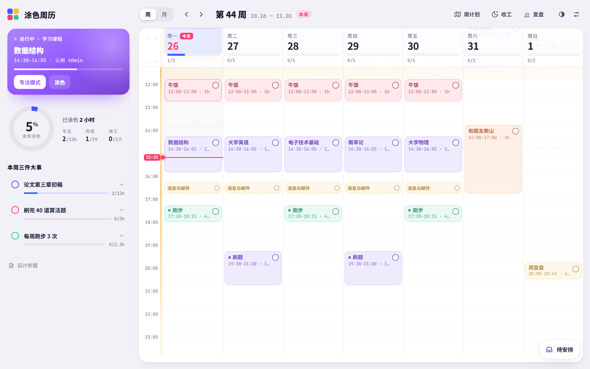
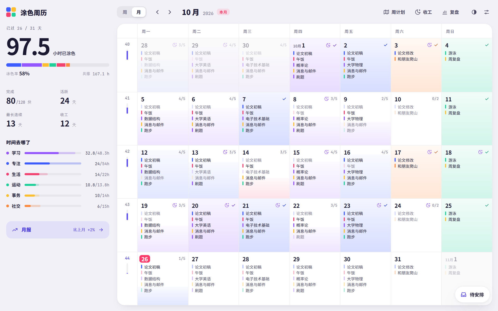

# 涂色周历 · Paint Your Week

把一周排成一块块时间，做完一块，就把它涂上颜色。





## 功能

- **周视图**
  - 在网格上拖出时间块，拖动或拉伸上下边缘就能改时间，拖动时实时显示落点时间。
  - 按住 Alt 拖动可以复制；支持撤销/重做和一整套快捷键（按 `?` 查看）。
- **待安排**
  - 右下角的浮动收件箱，输入「写报告 90min」会自动识别时长。
  - 可以拖进网格，也可以一键排进合适的空档；当前空档放得下的事，左侧卡片会直接提示「先做」。
- **涂色与结算**
  - 完成的块整块涂色，进度环、彩带和音效跟着动。
  - 一天全部涂满后可以「结算」，看当天的数据、称号、成就和色卡。
- **月视图与月报**
  - 整月按完成度上色。
  - 月报包含分类、每周、星期节律、一天中的时段、做得最多的事、大事完成情况。
- **周复盘**：亮点、时间去向、一周节奏、专注统计、近几周走势。
- **仪式**
  - 周计划：三件大事和 WOOP。
  - 收工仪式。
  - 专注模式。
- **能量曲线**：按作息类型（早鸟 / 中间 / 夜猫）标出高能时段，深度任务自动优先排进去。
- **课表导入**：支持五邑大学教务系统。
- **主题**：浅色、深色、跟随系统。
- **数据**
  - 默认存在浏览器本地。
  - 部署了后端时，输入用户名即可切换数据空间（没有密码，适合个人或小圈子使用）。

## 设计依据

时间块（time blocking）、执行意图（if-then 触发）、WOOP、三件大事、按昼夜节律安排高难任务、收工仪式（应对未完成任务带来的心理负担）等。应用内「设计依据」页列出了全部 13 项研究。

## 开发

需要 Node 18+。

```bash
npm install
npm run dev      # 本地开发
npm run build    # 输出到 dist/
```

代码是原生 JavaScript ES 模块，用 Vite 打包：

```text
src/
  core/    数据、同步、用户
  week/    周网格、方块、拖拽、编辑器
  month/   月视图
  side/    左侧卡片、统计、三件大事、结算
  inbox/   待安排
  pages/   复盘、月报、仪式、设置、导入
  ui/ fx/  弹窗、主题、彩带与音效
  styles/  样式
```

## 自己部署

- `dist/` 是纯静态文件，可以放在任意路径下。
- 不部署后端也能用，数据只保存在本机浏览器。
- 想要多设备同步时，需要部署 `server/` 里的后端：
  - `server.py`：Python 标准库 + SQLite，每个用户名一个数据空间，自带限流和容量上限；
  - `tuse-week.conf`：nginx 配置示例；
  - `tuse-week.service`：systemd 服务配置。
- `scripts/deploy.sh` 是作者自用的部署脚本，服务器地址和密码从仓库外的本地文件读取。
